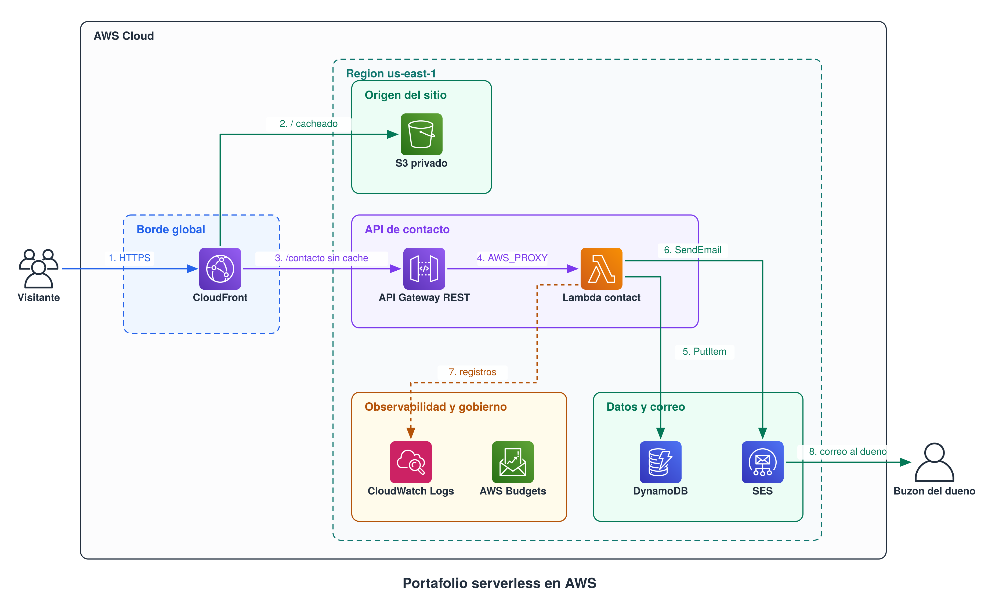

# Portafolio serverless en AWS

Proyecto del laboratorio de AWS CDK del curso de preparación para la certificación **AWS Certified Cloud Practitioner (CLF-C02)**.

Despliega un portafolio personal sobre una arquitectura real: sitio estático servido por CDN, protegido con firewall, y un formulario de contacto que guarda los mensajes y los reenvía por correo. Todo descrito como código, sin crear un solo recurso a mano.

## La arquitectura



El recorrido de una petición, siguiendo los números del diagrama:

1. El visitante entra por **CloudFront**, que sirve el sitio sobre HTTPS desde ubicaciones de borde.
2. La ruta raíz se sirve desde un bucket de **S3 privado**, al que solo CloudFront puede leer.
3. La ruta `/contacto` va a **API Gateway**, sin caché.
4. **Lambda** valida el mensaje.
5. Lo guarda en **DynamoDB**.
6. Lo envía por **SES** al correo del dueño.
7. Los registros quedan en **CloudWatch**.

CloudFront es un servicio global, por eso aparece fuera de la región en el diagrama: sirve el sitio desde ubicaciones de borde repartidas por el mundo, mientras el resto de los recursos vive en una sola región. La pila se despliega en `us-east-1`.

## Qué cuesta

**Menos de 1 USD al mes** con el tráfico de un portafolio personal. A este volumen casi todo cae dentro de capas gratuitas: CloudFront regala 1 TB de salida y 10 millones de peticiones al mes, y Lambda 1 millón de invocaciones.

El cobro es por hora y por uso, así que desplegar, probar y eliminar en la misma sesión cuesta centavos.

La pila crea un presupuesto con avisos a 1 y a 5 USD. Avisa, no detiene el gasto.

## Requisitos

- Node.js, versión LTS
- AWS CLI v2 con credenciales configuradas
- Una cuenta de AWS con la región **us-east-1** disponible
- Un correo al que tengas acceso, para verificar la identidad de SES

## Desplegar

Desde la carpeta `cdk`:

```bash
npm install
```

```bash
npx cdk deploy -c ownerEmail=tucorreo@ejemplo.com -c student=tunombre
```

El contexto `student` da nombre a la pila, de forma que varias personas pueden desplegar en la misma cuenta sin pisarse.

Durante la creación vas a recibir un correo de verificación de SES. **Ábrelo**: hasta entonces el formulario guarda el mensaje pero no puede enviarlo.

La distribución de CloudFront tarda varios minutos. Si prefieres ver la plantilla generada sin crear nada, usa `npx cdk synth` con los mismos parámetros.

## Publicar el sitio

La pila crea el bucket vacío. Los archivos de `site/` se suben después:

```bash
BUCKET=$(aws cloudformation describe-stacks \
  --stack-name portafolio-tunombre --region us-east-1 \
  --query "Stacks[0].Outputs[?OutputKey=='SiteBucketName'].OutputValue" \
  --output text)

aws s3 sync site "s3://$BUCKET/" --delete
```

Después abre la URL que aparece en la salida `SiteUrl`.

Si editas el sitio y vuelves a subirlo, los cambios no se ven de inmediato: CloudFront cachea 24 horas. Hay que invalidar la caché de la distribución.

## Estructura

| Carpeta | Contenido |
|---|---|
| `cdk/` | El proyecto de CDK. Su propio README explica los constructs y los comandos |
| `lambda/` | Código de la función de contacto, en Python |
| `site/` | El portafolio estático que se sube al bucket |
| `arquitectura/` | Generador de los diagramas, y los diagramas en PNG y SVG |

La infraestructura está separada en constructs por responsabilidad, uno por archivo bajo `cdk/lib/constructs/`. El detalle de cada uno, y por qué son constructs dentro de una sola pila en lugar de varias pilas, está en [`cdk/README.md`](cdk/README.md).

## Eliminar todo

El bucket tiene versionado, así que hay que vaciarlo antes. Desde la consola, el botón **Vaciar** se encarga también de las versiones ocultas, que es lo más simple.

Después, desde la carpeta `cdk`:

```bash
npx cdk destroy -c ownerEmail=tucorreo@ejemplo.com -c student=tunombre
```

Si ejecutaste `cdk bootstrap`, queda además una pila llamada `CDKToolkit` con su propio bucket. `cdk destroy` no la elimina: hay que borrarla desde la consola de CloudFormation.

La distribución de CloudFront tarda varios minutos en desactivarse y borrarse, así que la pila no pasa a estado eliminado de inmediato.

## Regenerar los diagramas

```bash
cd arquitectura
pip install diagrams
python3 arquitectura.py
```

El paquete `diagrams` se instala solo por los iconos oficiales de AWS que trae; el dibujo se arma a mano en SVG. Para convertir el SVG a PNG hace falta `rsvg-convert`, que en macOS viene con `brew install librsvg`.
